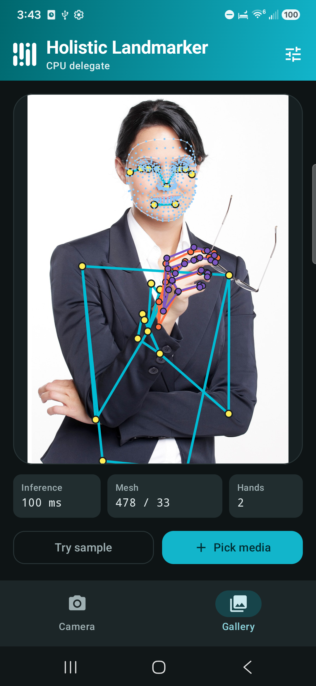

# MediaPipe Tasks Holistic Landmarker Android Demo

### Overview

This Jetpack Compose Android app detects holistic landmarks (pose, face mesh, and left/right hand
skeletons) from live camera frames (`CameraX` + `RunningMode.LIVE_STREAM`), bundled sample media, or
device photos and videos (`RunningMode.IMAGE` / `RunningMode.VIDEO`).



### Prerequisites

* Android Studio or JDK 17 with Android SDK (`compileSdk = 36`, `minSdk = 28`).
* An Android device or emulator (physical device recommended for live camera inference).

### Building & Testing

From `examples/holistic_landmarker/android`:

```bash
# Download and verify the SHA-256 of holistic_landmarker.task
./gradlew :app:verifyModels

# Run unit tests
./gradlew :android-common:testing:testDebugUnitTest

# Build debug & androidTest APKs
./gradlew :app:assembleDebug :app:assembleDebugAndroidTest

# Run real-model & Compose UI instrumentation tests on a connected device/emulator
./gradlew :app:connectedDebugAndroidTest
```

### Models used

Downloading and SHA-256 verification of `holistic_landmarker.task` into `app/src/main/assets` is
managed automatically by [download_tasks.gradle.kts](app/download_tasks.gradle.kts).
