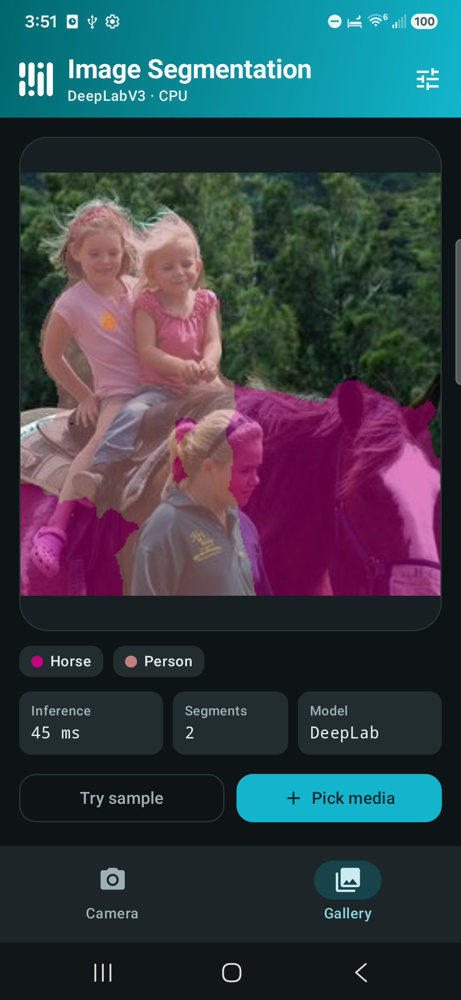

# MediaPipe Tasks Image Segmentation (Category Mask) Android Demo

### Overview

This Jetpack Compose Android app segments people and objects in live camera frames (`CameraX` +
`RunningMode.LIVE_STREAM`), bundled sample media, or device photos and videos (`RunningMode.IMAGE`
/ `RunningMode.VIDEO`) using color-coded category masks across DeepLabV3, Hair Segmenter, Selfie
Segmenter, and Selfie Multiclass models.



### Prerequisites

* Android Studio or JDK 17 with Android SDK (`compileSdk = 36`, `minSdk = 24`).
* An Android device or emulator (physical device recommended for live camera inference).

### Building & Testing

From `examples/image_segmentation/android/category_mask`:

```bash
# Download and verify SHA-256 checksums for all 4 segmentation models
./gradlew :app:verifyModels

# Run unit tests
./gradlew :android-common:testing:testDebugUnitTest

# Build debug & androidTest APKs
./gradlew :app:assembleDebug :app:assembleDebugAndroidTest

# Run real-model & Compose UI instrumentation tests on a connected device/emulator
./gradlew :app:connectedDebugAndroidTest
```

### Models used

Downloading and SHA-256 verification of all `.tflite` models into `app/src/main/assets` is managed
automatically by [download_models.gradle.kts](app/download_models.gradle.kts).
