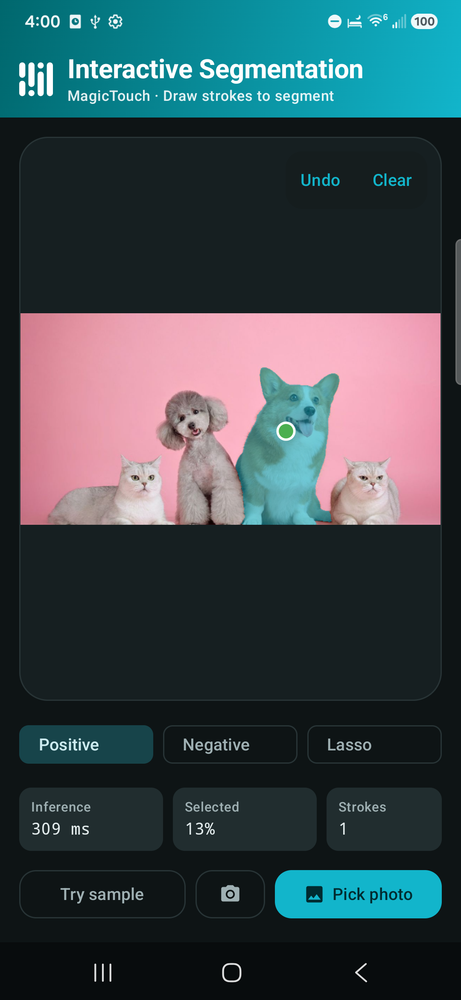

# MediaPipe Tasks Interactive Image Segmentation Android Demo

### Overview

This Jetpack Compose Android app lets users load a sample photo, pick an image from the device, or
capture a camera photo, then draw **Positive**, **Negative**, or **Lasso** strokes to isolate objects
using the MagicTouch interactive segmentation model (`interactive_segmentation.task`).



### Prerequisites

* Android Studio or JDK 17 with Android SDK (`compileSdk = 36`, `minSdk = 28`).
* An Android device or emulator.

### Building & Testing

From `examples/interactive_segmentation/android`:

```bash
# Download and verify the SHA-256 of interactive_segmentation.task
./gradlew :app:verifyModels

# Run unit tests
./gradlew :android-common:testing:testDebugUnitTest

# Build debug & androidTest APKs
./gradlew :app:assembleDebug :app:assembleDebugAndroidTest

# Run real-model & Compose UI instrumentation tests on a connected device/emulator
./gradlew :app:connectedDebugAndroidTest
```

### Models used

Downloading and SHA-256 verification of `interactive_segmentation.task` into `app/src/main/assets`
is managed automatically by [download_model.gradle.kts](app/download_model.gradle.kts).
